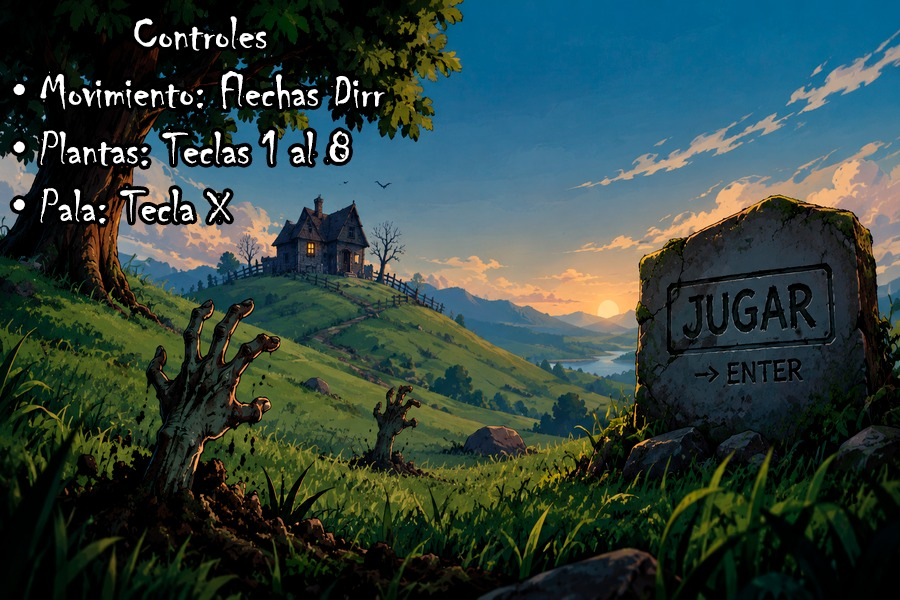
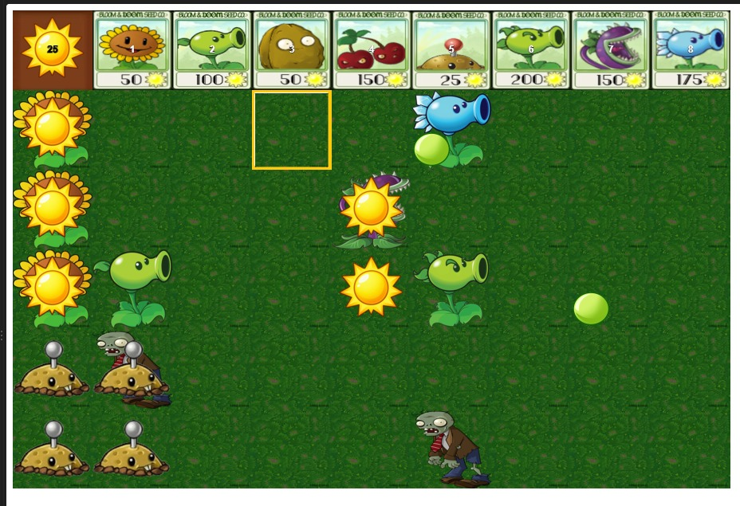
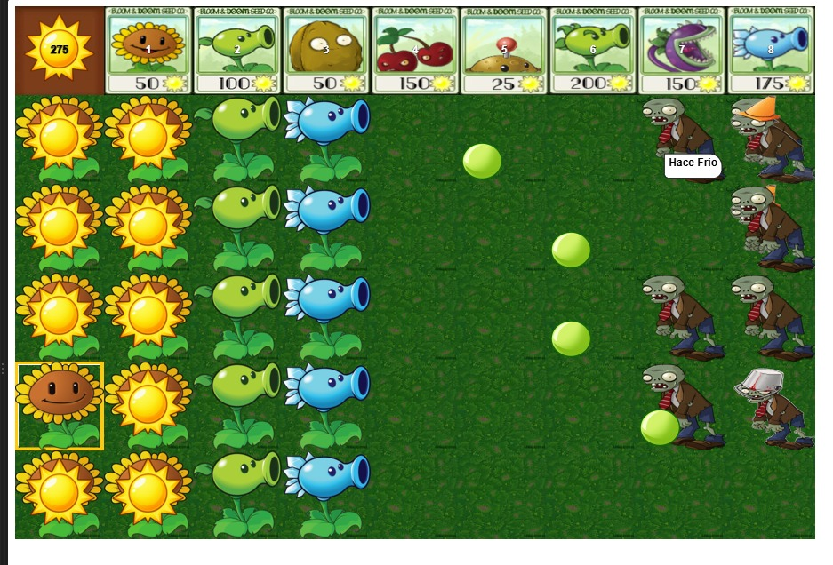

_(Sugerencia de documento del juego, pueden poner otros detalles, pero lo mejor es tratar de incluir info de instrucciones y otos detalles en el propio juego también)_

# Plantas Vs Zombies 

_(Git Grupal: https://docs.google.com/presentation/d/1-o5zEUfuUT72ea8q2rk8mwHSqMkdJvTyQ9Y8eqUTVZA/edit?usp=sharing)_

## Equipo de desarrollo

• Ramiro Porcuna
• Kevin Ontiveros
• Francisco Rizo Patrón

## Capturas

## Reglas de Juego / Instrucciones

## Idea del juego: 
Nuestra idea fue hacer una version modificada de plantas vs zombies para wollok. Enforcada mas en un estilo arcade.
Se usa un cabezal para moverse en un tablero 9 x 5, donde podes elegir donde poner tus plantas para defenderte.
El juego te da 8 plantas para usar y una pala para sacarlas, mientras distintos tipos de zombies siguen llegando por el lado derecho del tablero
El objetivo es aguantar lo maximo posible. Al finalizar el juego, se mostrara cuantos zombies asesinaste y cuantas oleadas resististe

## Controles:
•Movimiento Cabezal: Tecla Izq 
                     Tecla Der 
                     Tecla Arr
                     Tecla Abj
•Plantas: Girasol (Tecla 1)
          Lanzaguisantes (Tecla 2)
          Nuez (Tecla 3)
          Petacereza (Tecla 4)
          Patapum (Tecla 5)
          Repetidora (Tecla 6)
          Planta Carnivora (Tecla 7)
          Hielaguisante (Tecla 8)
•Pala: Tecla X

## Otros

Curso: Programacion con Objetos I, Comisión 4
Facultad: Universidad Nacional De Quilmes
